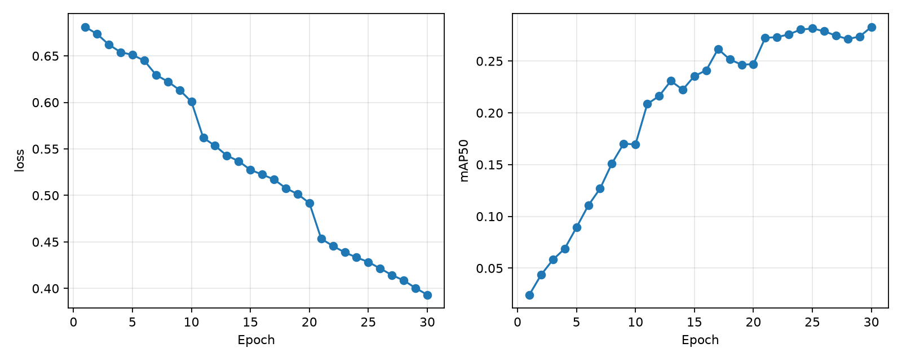

# 机器视觉技术期末实验报告

姓名：孙涛　学号：2631101265

## 任务与方法
使用 PASCAL VOC 的 20 个目标类别完成目标检测。设计轻量残差卷积骨干，使用 GroupNorm 和 SiLU，提取步长为 8、16、32 的三个尺度特征；FPN 将通道统一为 128。检测部分复用 torchvision Faster R-CNN 的 RPN、RoIAlign 和分类回归组件，不声称完整原创检测器。模型随机初始化，从零训练。未使用外部预训练权重。

## 数据与实验设置
VOC2007 官方 train 用于训练、val 用于模型选择。训练移除 difficult 标注，评估匹配到 difficult 目标的预测不计入正负例。训练增强包括水平翻转和颜色/亮度扰动。训练图片 2501 张，验证图片 2510 张。

初始学习率 0.005，batch size 2，本实验计划 30 轮，已完成 30 轮，随机种子 42。模型参数 11,147,431 个，设备 cuda。学习率策略 step，预热 0 次迭代。训练及评估短边固定为 512。

## 验证集结果
以下数据来自本次日志。评估采用 IoU=0.5 的 VOC2007-11point AP，非 COCO mAP@[.5:.95]。最佳验证 mAP@0.5 为 **0.2829（28.29%）**。无非困难目标的类别不计入均值。

| 验证类别 | 验证 AP@0.5 |
|---|---:|
| aeroplane | 0.3869 |
| bicycle | 0.3849 |
| bird | 0.1693 |
| boat | 0.2090 |
| bottle | 0.0952 |
| bus | 0.3447 |
| car | 0.4599 |
| cat | 0.2827 |
| chair | 0.1631 |
| cow | 0.1240 |
| diningtable | 0.2360 |
| dog | 0.2717 |
| horse | 0.4688 |
| motorbike | 0.4277 |
| person | 0.4738 |
| pottedplant | 0.0749 |
| sheep | 0.2079 |
| sofa | 0.2147 |
| train | 0.3281 |
| tvmonitor | 0.3356 |

## 测试集结果
最终测试 mAP@0.5 为 **0.3048（30.48%）**，评估图片 4952 张。验证减测试的差值为 -2.19 个百分点。该差异不能单独证明过拟合，需结合数据分布与预测案例分析。

| 测试类别 | 测试 AP@0.5 |
|---|---:|
| aeroplane | 0.3974 |
| bicycle | 0.3629 |
| bird | 0.1780 |
| boat | 0.1682 |
| bottle | 0.0815 |
| bus | 0.3311 |
| car | 0.4995 |
| cat | 0.2355 |
| chair | 0.1493 |
| cow | 0.3005 |
| diningtable | 0.3442 |
| dog | 0.2398 |
| horse | 0.5004 |
| motorbike | 0.4396 |
| person | 0.5022 |
| pottedplant | 0.1552 |
| sheep | 0.2736 |
| sofa | 0.1909 |
| train | 0.4156 |
| tvmonitor | 0.3314 |

## 结果分析
本次训练第一轮平均损失为 0.6811，末轮为 0.3931。已记录轮次中，第 30 轮验证 mAP 最高，为 0.2829。若从已有权重初始化，best.pt 也可能保留继续训练前的模型，不能将上述轮次误称为最终权重所属轮次。

验证集上表现较好的类别为 person（47.38%）、horse（46.88%）、car（45.99%）；较弱的类别为 pottedplant（7.49%）、bottle（9.52%）、cow（12.40%）。小目标、遮挡、复杂背景和类别样本差异是待验证的可能原因，需结合预测框与真实标注逐项检查，不能仅凭 AP 表确定原因。

仅凭训练损失下降不能证明泛化性能提高，也不能单独判断过拟合。调参依据验证集；测试集仅用于最终报告，不用于挑选学习率或输入尺寸。建议保存多张成功、漏检、误检和定位偏差案例，并在此补充具体图片分析。

## 改进实验与局限
新增的继续训练、线性预热、余弦学习率和多尺度输入提供可复现的对照条件，不代表已经提高指标。先固定输入为 512 比较继续训练，再比较 640 与多尺度配置，记录额外训练成本。继续训练的总训练轮数须包含初始化检查点此前的训练，不应与仅训练 30 轮的基线声称等预算比较。

自定义骨干从零学习，数据量有限；小目标和遮挡目标仍可能具有挑战。应报告实际验证变化；若没有提升，应保留基线并说明负结果。

## 复现与参考
复现命令见项目 README。参考 torchvision Faster R-CNN、FeaturePyramidNetwork、PASCAL VOC 评估协议以及 PyTorch 学习率调度文档。应如实注明第三方组件与工具辅助。
